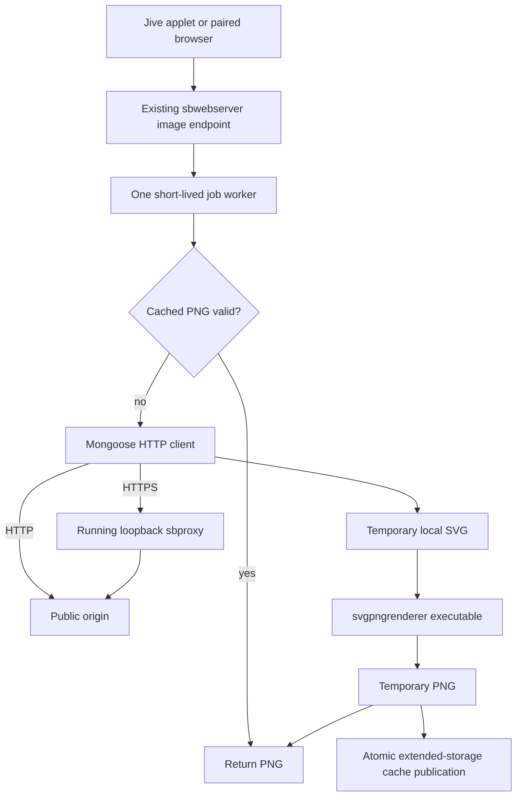

# Native SVG artwork rendering

Standalone Base offers a generic PNG URL for SVG artwork. The feature is split
between an isolated local-file renderer and the existing webserver. Neither
the renderer nor the webserver links libcurl, wolfSSL, Cairo or another TLS or
graphics framework. No new permanent daemon is started.



## Renderer

```sh
svgpngrenderer --input /tmp/logo.svg --output /tmp/logo.png \
  --width 320 --height 320
```

The renderer reads only a regular local file and writes an atomic PNG. It has
no URL, networking, HTTP, TLS, caching or daemon functionality. Dimensions
default to 320 by 320, with independent integer limits of 16 through 512.
The SVG viewport fits entirely within the requested transparent RGBA canvas,
with uniform scaling and centering. NanoSVG handles viewBox-only SVGs and
derives bounds when both dimensions and viewBox are absent.

The selected libraries are pinned, unmodified NanoSVG/NanoSVG rasterizer and
stb_image_write. NanoSVG is C with no graphics dependencies and uses the zlib
license; stb is used under MIT. Revision identifiers and full license notices
are in `native/svgpngrenderer/THIRD_PARTY.md`, also included in release ZIPs.
See [NanoSVG upstream](https://github.com/memononen/nanosvg) and
[stb upstream](https://github.com/nothings/stb).

NanoSVG is appropriate for path-based station logos, supporting paths, basic
shapes, fills, strokes, opacity, linear/radial gradients, transforms, viewBox
and its named color table. The wrapper accepts a deliberately narrow SVG/XML
vocabulary rather than silently dropping unsupported graphical elements.
LunaSVG was not added: its broader C++ renderer would increase build and binary
complexity without being necessary for this initial subset.

Unsupported input includes text/fonts, embedded stylesheets, CSS classes,
images, use/symbol instances, masks, clipping paths, filters, scripts,
animation, arbitrary metadata/RDF elements, DTDs and entity-bearing attributes.
Inline presentation styles are accepted, but unsupported effects in those
styles are rejected. External references are never fetched. Gradient fragment
references such as `url(#gradient)` are allowed. Full browser SVG/CSS
compatibility is not claimed. Use PNG artwork or export plain path-based SVG
when an input is rejected. An SVG's own viewport/preserveAspectRatio settings
are interpreted by NanoSVG before the output canvas is fitted.

Exit codes: 0 success; 64 invalid CLI/dimensions; 65 invalid, empty, oversized or
unsupported SVG; 66 unreadable/non-regular input; 73 output failure;
75 allocation, geometry or resource failure. The OS can also terminate the
process on CPU/address-space limits. Errors and timing go to stderr without
printing SVG content or filesystem paths.

## HTTP API

```text
GET  /api/image/render?url=ENCODED_HTTP_OR_HTTPS_URL&width=320&height=320
HEAD /api/image/render?url=ENCODED_HTTP_OR_HTTPS_URL&width=320&height=320
POST /api/image/render?width=320&height=320   Content-Type: image/svg+xml
```

GET accepts an original source URL, not a pre-translated proxy URL. The source
does not need an `.svg` extension: actual content is validated by the renderer,
so SVG MIME endpoints and extensionless URLs are supported. Normal PNG/JPEG/GIF
artwork should continue using its normal loading path.

POST converts SVG data already stored locally: an authorized caller reads its
file and posts the bytes. There is deliberately no API that accepts arbitrary
server filesystem paths. POST accepts a paired browser or the existing trusted
loopback Jive capability (`X-Remote-Capability`). Browser requests use existing
session cookies and same-origin checks; applets never need a browser session.

GET/HEAD also allow local Jive image requests with a literal loopback Host and
without browser Origin/Sec-Fetch-Site headers. Non-loopback clients require an
existing paired browser session. A reverse proxy must preserve the original
Host and browser headers: do not turn external requests into indistinguishable
trusted loopback requests. No internal capability is put in image URLs.

Success: `image/png`, correct Content-Length, `Cache-Control: private,
max-age=86400`, `X-Content-Type-Options: nosniff`, `Referrer-Policy: no-referrer`
and `X-SB-Image-Cache: hit|miss`. HEAD can populate a missing cache entry but
returns no PNG body. Errors are generic JSON without source URLs or local
paths: 400 invalid parameters, 401 pairing required, 403 access/destination
rejected, 405 method unsupported, 413 input too large, 415 malformed/unsupported
SVG, 502 download failure, 503 busy/resource/renderer/proxy-capability failure,
504 deadline exceeded. Download failures do not create PNG cache entries.

Local example using the actual configured webserver port:

```sh
curl --get --data-urlencode 'url=https://example.org/logo.svg' \
  --data 'width=320&height=320' "http://127.0.0.1:$WEB_PORT/api/image/render" \
  --output /tmp/logo.png
curl -b browser-cookies.txt -H 'Content-Type: image/svg+xml' \
  --data-binary @logo.svg "http://RADIO_HOST:$WEB_PORT/api/image/render" \
  --output logo.png
```

## Downloads and security

Ordinary HTTP reuses Mongoose's HTTP client in the worker's own event loop.
DNS runs in the worker; every returned IPv4 address must be public. A numeric
validated address is used for the actual connection, while preserving the
original Host header. This avoids a DNS validation/connect rebinding gap.
Each HTTP redirect destination is validated and resolved again. Absolute and
root-relative redirects are supported; other relative redirect forms fail
closed. Only ordinary HTTP/HTTPS ports are accepted. IPv6 source URLs are
currently unsupported. Credentials, fragments, control bytes, ambiguous URL
authorities and unsafe schemes are rejected.

HTTPS uses the existing running proxy on `127.0.0.1:8765`, whose actual interface
is `/https/example.org/path`. `SB_IMAGE_PROXY_URL` is a local operator override
for installations running that proxy on another loopback port. No TLS stack is
introduced into either new component.

The original proxy followed redirects without a public-address restriction.
That made webserver-only validation insufficient: a public URL could redirect
to a private address. The minimal correction is opt-in
`X-SB-Public-Fetch: 1`. For those requests only, libcurl's open-socket callback
rejects non-public IPv4 addresses and nonstandard service ports on every
connection, including redirects. Environment HTTP proxies are disabled for
these requests and redirect protocols are limited to HTTP/HTTPS. Ordinary
proxy traffic retains its existing behavior. The internal policy header is
not forwarded upstream.

The proxy advertises this policy in its `/health` response. The image worker
checks that capability before sending an HTTPS source URL and fails closed
with 503 against an older proxy. A new installation must update both bundled
binaries together. There is no alternate proxy route or new TLS dependency.

HTTP has at most three redirects; the existing proxy's restricted transfer
also has at most three redirects. A mixed HTTP-to-HTTPS chain can therefore
contain up to six redirects, always under the overall download deadline and
the public-destination policy. No SVG-referenced resources are downloaded.

The proxy's pre-existing legacy TLS certificate-verification policy is
unchanged; see `docs/security.md`. Address restrictions are SSRF protection,
not a new claim of authenticated upstream TLS.

## Resource limits and cache

Only one job runs at a time, with up to two clients waiting for an identical
key. A different concurrent job or additional waiter gets 503. The job worker
forks/execs the renderer with an argument array, without shell interpolation.
Inherited server sockets are closed in the worker. The renderer is a temporary
second child, not a persistent service. The parent drains a nonblocking result
pipe in its existing event loop and reaps the worker. Disconnected callers do
not leave an unbounded job. No new idle polling is introduced.

Limits: 1 MiB SVG input, 4095-byte source URL, 512 by 512 output, 2 MiB PNG,
4096 XML elements, 64 nesting levels and 32768 path points. The renderer has
a 32 MiB address-space ceiling and five CPU-second limit. The job worker has
a 40 MiB address-space ceiling, an eight-second overall download deadline and
a 20-second overall watchdog. The watchdog kills the entire worker process
group and removes temporary files. These are safety ceilings, not expected
resident-memory consumption or device latency guarantees.

The cache is `/mnt/sbdata/cache/svg-render/` only when that mount is UBI/UBIFS.
Otherwise rendering proceeds without a persistent cache. It never falls back
to the small original firmware writable partition. Private temporary files
use a random mode-0700 directory under `/tmp` and are removed after the job.

SHA-256 keys include normalized source (scheme/host case and default ports),
dimensions, source kind and a renderer-options revision. POST uses the SVG
content hash. TTL is seven days from file modification; hits do not refresh
it. Changing renderer semantics requires incrementing the key revision.
Hits read the PNG without downloading or invoking the renderer. The disk
budget is 20 MiB and at most 256 entries. Oldest entries are removed before
new PNG publication. Expired entries are reclaimed on misses. There is no
background eviction or persistent access log. A private pending file and
same-directory rename prevent partial publication; a pending file left by a
crash is reclaimed after 60 seconds on a later miss. Cache write failures
still permit uncached responses.

Local overrides `SB_IMAGE_RENDERER`, `SB_IMAGE_CACHE_ROOT` and
`SB_IMAGE_PROXY_URL` support host testing/operator configuration. Keep actual
deployment values in ignored local configuration. `SB_IMAGE_DIAGNOSTICS=1`
adds per-job result/cache information; normal hits are quiet. Download
start/completion, input byte count, conversion errors, output dimensions,
render duration, PNG size and renderer peak RSS are logged without URLs or
query secrets. Peak RSS is the process high-water mark and can include an
inherited pre-exec high-water mark; measure isolated launches when comparing.

## Applet integration

`ImageRender.lua` and the `getStandaloneImageURL` Jive service provide a common
helper. It reads the configured webserver port and leaves ordinary artwork
URLs unchanged. The optional MIME argument handles extensionless SVGs.

```lua
local pngUrl = appletManager:callService(
    "getStandaloneImageURL", sourceUrl, 320, 320, "image/svg+xml")
-- Pass pngUrl to the applet's normal HTTP image/cache loader.
```

The companion Standalone Radio checkout uses this service in UrlTransport,
before its existing HTTPS translation. LogoCache no longer rejects `.svg`
and retries XML/SVG-MIME downloads once through the native endpoint. There is
no Lua SVG parser or rasterizer. Its pre-existing 512 KiB logo-cache limit and
383-byte Now Playing artwork URL limit still apply; very long encoded SVG
URLs may not fit the latter. Existing PNG/JPEG/GIF routing is preserved.
Changes in the companion checkout are separate from this repository's build.

## Build, tests and observed results

Changed source groups:

- `native/svgpngrenderer/`: CLI, CMake target, pinned headers and licenses.
- `native/sbwebserver/src/image_render.[ch]`, `http_server.c` and its CMake file:
  endpoint, download worker, renderer invocation, cache and routing.
- `native/common/public_address.h` and `native/sbproxy/sbproxy.c`: shared public
  address policy and the opt-in proxy socket restriction.
- `applet/ImageRender.lua`, `StandaloneBaseApplet.lua`, `StandaloneBaseMeta.lua`:
  reusable artwork service and executable permissions.
- Root CMake, ARM build, both package scripts and `scripts/deploy_dist.py`:
  native build and distribution integration.
- `tests/images/` and `tests/CMakeLists.txt`: offline checks, optional online
  samples/reference comparison and test registration.
- `README.md` and this document: API, limits, operation and measurements.
- Companion `C:/Projects/squeezebox/applet/StandaloneRadio/UrlTransport.lua` and
  `LogoCache.lua`: optional service use, MIME recognition and one-time retry.

Linux host: C compiler, libc and libm; normal CMake build includes
`svgpngrenderer`. `scripts/build-arm.sh` cross-compiles and statically links it
for the existing ARMv5 musl toolchain. The endpoint's sibling-executable lookup
finds it next to `sbwebserver`. Both package scripts include the executable,
Lua helper and third-party notices. The applet and deployment script set its
executable bit. No dynamic runtime graphics/network dependency is required.

Tests are wired into CTest where supported. Direct equivalents:

```sh
python3 tests/images/test_renderer.py /path/to/svgpngrenderer
python3 tests/images/test_image_http.py /path/to/sbwebserver \
  /path/to/svgpngrenderer native/sbwebserver/web
python3 tests/images/test_proxy_guard.py /path/to/sbproxy
```

For deterministic HTTP-origin tests, compile the host webserver with
`SB_IMAGE_TESTING` and run `test_image_http.py` with `--test-network`. Its
`image.test` mapping is compiled out of release binaries. This covers actual
downloads, redirects, unsafe redirect targets, size rejection, concurrency,
request coalescing and event-loop responsiveness. The normal HTTP test also
covers pairing, local upload, error handling, expiry, cache capacity and
uncached fallback. Renderer tests decode PNG chunks/CRCs and RGBA pixels to
check dimensions, gradients, alpha, aspect ratio, viewBox, invalid/unsupported
input and geometry limits. The shared address policy has a C unit test.

Optional `benchmark_logos.py` downloads Wikimedia samples into a selected
untracked temporary directory; it is not part of offline CI. On the host,
BBC Radio Logo 2020 and Deutsche Welle Logo rendered at 320 by 320. The older
BBC Radio logo was explicitly rejected because of metadata/RDF vocabulary.
Source descriptions: [BBC 2020](https://commons.wikimedia.org/wiki/File:BBC_Radio_Logo_2020.svg),
[DW](https://commons.wikimedia.org/wiki/File:Deutsche_Welle_Logo.svg),
[older BBC](https://commons.wikimedia.org/wiki/File:BBC_Radio_logo.svg).

The optional ctypes-based `compare_reference.py` uses already installed host
librsvg/Cairo, never production dependencies. BBC 2020 mean premultiplied
channel error was 0.033/255, with 0.35% of pixels differing by more than 16;
DW was 0.112/255 and 0.45%, respectively. These comparisons reflect the tested
samples rather than full SVG compatibility.

An isolated x86 host BBC 2020 conversion took about 22 ms and peaked at
2944 KiB RSS. The ARMv5 binary under QEMU took about 153 ms of reported
conversion time (about 210 ms process wall time); QEMU's observed 8780 KiB RSS
includes the emulator and is not a device-memory measurement. Pixel tests
also passed using the ARM executable under QEMU.

Final ARM size-tool totals: renderer 121876 bytes; sbwebserver 204024 bytes
(about 29 KiB increase); restricted proxy change about 0.6 KiB. Exact final
values may vary with toolchain/optimization. The initial implementation checks
used the host and QEMU; subsequent device deployment is recorded below.

The optional `test_https_fetch.py` also passed against a locally running host
sbproxy: an actual Wikimedia HTTPS SVG was fetched, rendered and subsequently
served as a cached PNG. A live public redirect fixture rejected the test at
its origin (403), so that Internet redirect case is not claimed as validated;
deterministic HTTP redirect and proxy private-address tests cover the offline
security suite.

## Physical deployment validation (2026-10-16)

Deployed the current package to the test Radio running SqueezePlay 7.7.3
r16676, with extended storage active. Backed up the installed applet and
configuration to ignored local storage and preserved the device catalog
byte-for-byte. Verified that the running sbbase, sbwebserver and sbproxy
binaries match the build, and that the proxy advertises the public-fetch guard.

Physical checks passed:

- A local SVG submitted over the trusted internal channel produced a valid
  64 by 64 transparent gradient PNG (259 bytes), followed by a cache hit.
- A BBC Radio 2020 SVG downloaded over HTTPS through the running proxy
  produced a valid 320 by 320 PNG (8053 bytes), followed by a cache hit.
- Renderer-reported conversion times were 101.6 ms for the small gradient
  and 1444.1 ms for the BBC logo on this device.
- Applied only the SVG integration changes to the installed Standalone Radio
  UrlTransport/LogoCache files, preserving the rest of their installed content.
  Refreshed SqueezePlay to load them; no full-device reboot was required.

This kernel returned zero for renderer peak RSS, so no usable physical memory
measurement was obtained. These are two smoke samples, not a worst-case
performance test or a long-running audio/playback validation.
